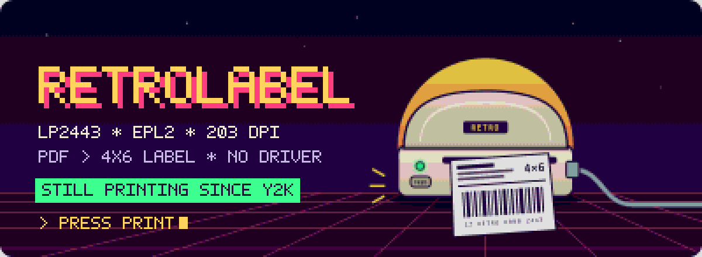
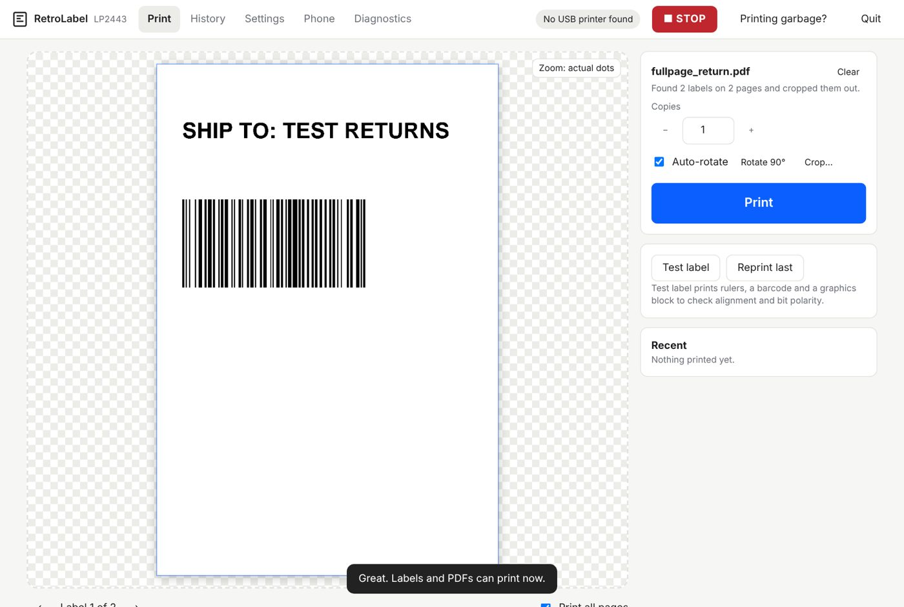

# RetroLabel LP2443

**Print 4×6 shipping labels from PDFs on a vintage Zebra/Eltron LP 2443, with no printer driver needed.**

Drop a PDF on the window (or just save it to your Downloads folder), check the preview, press **Print**.
RetroLabel is the driver: it renders the PDF to the printer's own 203 dpi dots and talks EPL2 straight to the printer
through a USB-to-parallel cable.

> Works with Zebra/Eltron LP 2443 and other EPL2 printers. **Not affiliated with or endorsed by Zebra Technologies.**
> Zebra and Eltron are trademarks of Zebra Technologies Corporation.

## Why

The LP 2443 (Eltron "Orion", c. 1999–2002) is a tough little direct-thermal printer that still turns up cheap on eBay. Zebra
ended support for it long ago: today's Zebra driver doesn't list it, PCs no longer have parallel ports, and shipping sites
hand out letter-size PDFs. RetroLabel deals with all of that.

## Features

- **No driver, no Windows printer setup.** Talks directly to the USB printer-class device that a USB-to-parallel cable
  (e.g. StarTech ICUSB1284) creates, on any USB socket.
- **Drag & drop or auto-pickup.** Save a label PDF to Downloads and it pops up already cropped (only PDFs that look like
  labels: barcode, 4×6 page or cut-line box). Nothing prints without your click.
- **Auto-crop.** Finds the label inside full-page printouts (Amazon/UPS/USPS returns with dashed cut lines, eBay labels
  blown up to letter size), rotates it and scales it to 4×6. Or **drag your own crop box**.
- **Barcode check.** Every preview decodes the barcodes from the PDF *and* from the exact printed dots, and warns you if one
  wouldn't scan.
- **Exact preview** of the 1-bit bitmap the printer will burn (with a "zoom to actual dots").
- **Barcode-safe rendering.** Vector render at 4× then area-averaged onto the 203 dpi grid, so bar edges land on whole dots.
  (PDFium alone widens rectangular bars by up to a dot.)
- **Phone printing** over your Wi-Fi from a phone web page (pair once with a QR code), plus an **iPhone Share-sheet
  shortcut**: Share → *Print on LP2443*. Optional approve-on-PC, auto-delete of uploads, revoke any phone.
- **Safety:** STOP button, paper-safe first run, *"Printing garbage?"* rescue, and optional **self-healing Line-mode
  protection** (see below), confirm before >5 labels.
- **Diagnostics** with a copyable report, raw-text and calibration test labels, X/Y offsets, darkness, speed.
- **Update notice** when a newer GitHub release exists (never auto-installs).

## Install (Windows 10/11 x64)

1. Download `RetroLabel-Setup-x.y.z-x64.exe` from **[Releases](../../releases)** (the plain .exe, not a zip).
2. Windows SmartScreen: **More info → Run anyway** (the app is not code-signed yet).
   If **Smart App Control** is on it blocks unsigned apps entirely. Turn it off under
   *Windows Security → App & browser control → Smart App Control*, or build and sign it yourself.
3. Connect: PC USB → USB-to-parallel cable → printer's **36-pin parallel** port. Printer on, 4×6 labels loaded.

Upgrading from "Zebra Label Printer" v1: just run the installer. It removes v1 and the app copies your settings,
history and paired phones.

## First run (once per printer)

1. Click **1. Send raw text test**. You should get one label reading *RAW EPL2 PATH OK* and two short lines, *nothing else*.
2. If it prints the commands themselves (`N`, `q812`, `D8`, `P1`…) or odd symbols, the printer is in **EPL Line Mode**.
   Click **It printed code lines / symbols**. The app sends `ESC EPL2` (Zebra's documented switch for the 2443/2844
   family). Power-cycle the printer and test again.
3. **Diagnostics → 2. Full test label**: the frame should touch all four edges, the GW square must be solid black, and the
   barcode must scan.
4. Optional: **Diagnostics → Line-mode protection → Run protection test** (2 small labels). If both print clean, every
   job is prefixed with the switch command, so a printer that slips into Line Mode fixes itself on the next print.

## Phone

- **Phone tab → allow phones → Show pairing QR code**, scan it on the same Wi-Fi, tap **Pair**.
- **iPhone Share button:** on the phone page open *Print from the Share button* and follow the six steps (Shortcuts app,
  *Get Contents of URL*, POST the shared PDF with your pairing key). Afterwards: any label PDF → Share → *Print on LP2443*.
  The barcode check runs first; it refuses to print a label whose barcode wouldn't scan.
- **Away from home:** don't port-forward. Use Tailscale (or an authenticated tunnel) to reach the PC privately.

## Troubleshooting

| Symptom | Fix |
|---|---|
| Prints command text / symbols, feeds many labels | **STOP**, then **Printing garbage?** → power-cycle → raw text test. Then run the protection test. |
| "No USB printer found" | Check cable and power, try another USB socket. Device Manager should show *USB Printing Support*. |
| Blank or negative labels | Settings → toggle *GW graphics: 0-bits are black*. |
| Shifted / cut off | Settings → X/Y offset nudge (8 dots ≈ 1 mm), confirm with the test label frame. |
| Barcode check fails | Raise Darkness, lower Speed, keep render smoothing at 4×, avoid scaling below ~80%. |
| Phone can't connect | Same Wi-Fi, app running (tray icon), Windows network set to *Private*, firewall option enabled. |

Use **Diagnostics → Copy report** when asking for help.

## Build from source

- **GitHub Actions:** every push to `main` runs the self-tests on Windows, builds the self-contained installer and publishes
  a Release (`.github/workflows/build-installer.yml`).
- **Locally (Windows + .NET 8 SDK):** `powershell -ExecutionPolicy Bypass -File build-installer.ps1`
- **Tests:** `dotnet run --project tests/LabelPrinter.SelfTest` (120+ checks: PDF rendering, exact bar widths, EPL2 byte
  round-trips, barcode decoding, auto-crop, job queue, folder watcher, phone pairing and security). Fixture PDFs are generated
  by `tests/make_fixtures.py` (reportlab).

Layout: `src/LabelPrinter.Core` (PDF → raster → EPL2, USB/spooler output, jobs, web UI and phone API),
`src/LabelPrinter.Desktop` (WinForms + WebView2 window and tray), `src/LabelPrinter.App` (headless host used for testing),
`installer/` (NSIS), `native/` (PDFium). Hardware notes and sources: [`docs/HARDWARE-RESEARCH.md`](docs/HARDWARE-RESEARCH.md).

## Status & honesty

Verified on one LP 2443 + StarTech ICUSB1284 on Windows 11. Other EPL2 models (LP/TLP 2844, 2824, GK420d…) and other
USB-parallel cables should work but are untested. Printable width (832 dots) is assumed from the 28xx family.

## License

MIT, see [LICENSE](LICENSE). Third-party components: [THIRD-PARTY-NOTICES.md](THIRD-PARTY-NOTICES.md).
